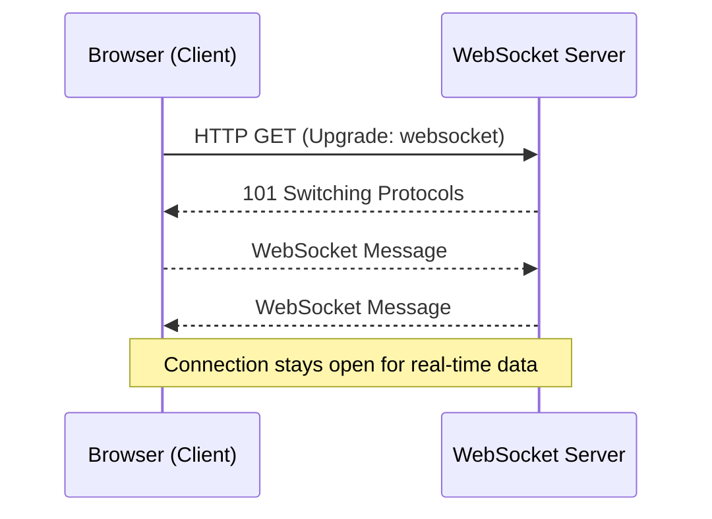
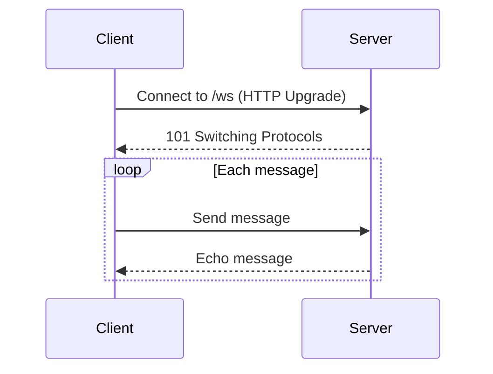
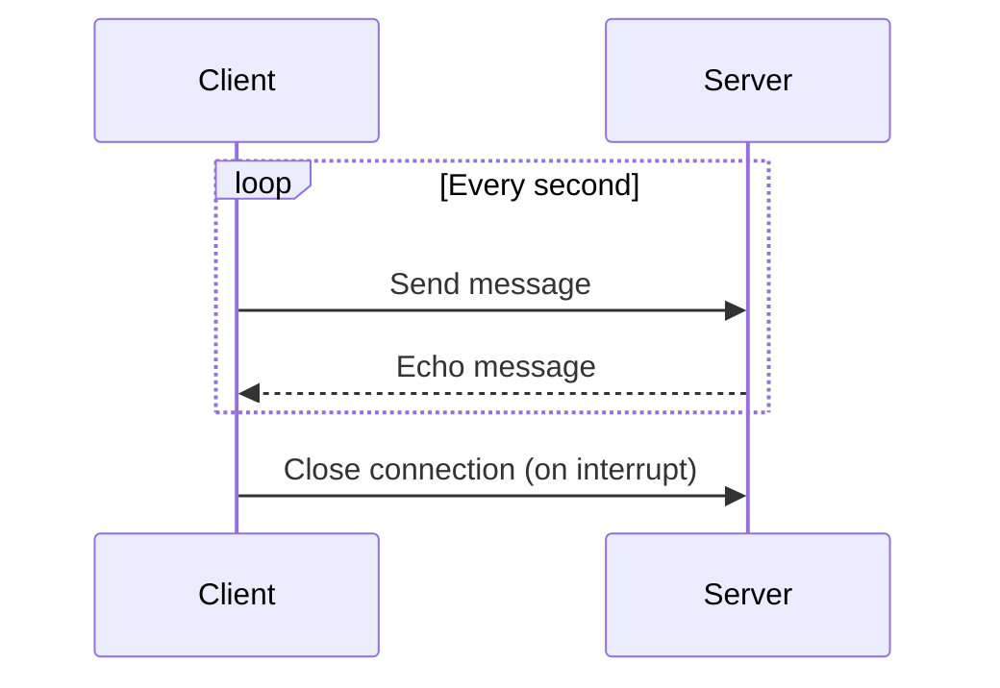
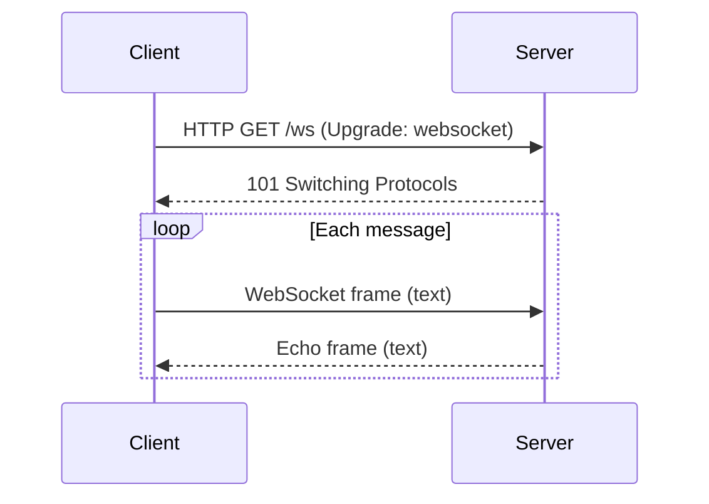
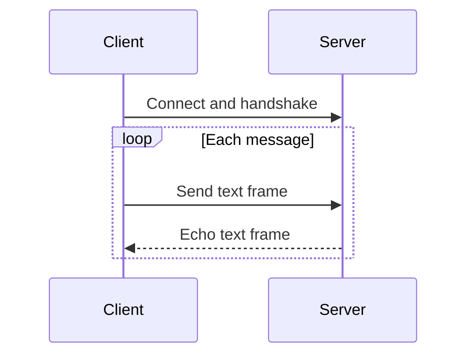
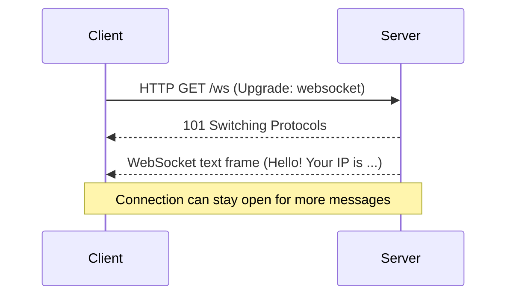
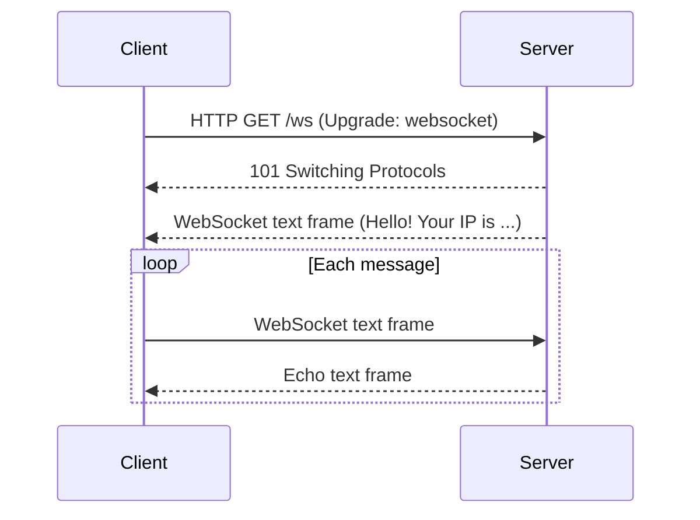

# WebSockets: Real-Time Communication in Go

> "Imagine a phone call instead of sending letters: both sides can talk and listen at any time, instantly. WebSockets turn HTTP from a one-way street into a two-way highway!"

---

## Why WebSockets? (Deeper Theory)
- **What are WebSockets?**
  - WebSockets are a protocol that enables full-duplex (two-way), persistent communication between a client (usually a browser) and a server over a single TCP connection.
  - Unlike HTTP, which is request/response and stateless, WebSockets keep the connection open, allowing both sides to send data at any time.
- **Why were they invented?**
  - Traditional HTTP is not efficient for real-time apps (e.g., chat, games, live dashboards) because it requires repeated polling or long-polling, which is slow and resource-intensive.
  - WebSockets solve this by providing a low-latency, always-on channel.
- **How do they work?**
  - Start as an HTTP request, then "upgrade" to the WebSocket protocol (RFC 6455).
  - After the handshake, both client and server can send messages independently.
- **When should you use WebSockets?**
  - When you need real-time, low-latency, bidirectional communication.
  - Examples: chat apps, collaborative editing, multiplayer games, live notifications, financial tickers, IoT device control.
- **When NOT to use WebSockets?**
  - For simple request/response APIs (REST), static content, or when you only need occasional updates (HTTP polling or SSE may be simpler).
  - If you need robust message delivery guarantees (use protocols like MQTT or AMQP).

---

## Networking Theory: Where Do WebSockets Fit?
- **Layer:** WebSockets operate at the application layer, on top of TCP.
- **Port:** Usually use the same ports as HTTP/HTTPS (80/443), so they work through most firewalls and proxies.
- **Protocol:** After the handshake, the protocol is no longer HTTP, but a binary framing protocol defined by RFC 6455.
- **Security:** WebSockets can be encrypted (wss://, over TLS/SSL) for secure communication.

---

## Advantages of WebSockets
- **Low latency:** No need to re-establish connections for each message.
- **Bidirectional:** Both client and server can send messages at any time.
- **Efficient:** Less overhead than HTTP polling or long-polling.
- **Scalable:** Good for apps with many simultaneous connections (with proper server design).

## Disadvantages of WebSockets
- **Stateful:** Server must keep track of open connections (uses more memory).
- **Complexity:** More complex to implement and debug than simple HTTP.
- **Not cacheable:** No built-in caching or intermediaries like HTTP.
- **Firewall/Proxy issues:** Some corporate proxies may block or interfere with WebSockets.
- **No built-in message delivery guarantees:** If you need guaranteed delivery, you must implement it yourself or use another protocol.

---

## Go Packages for WebSockets
- **gorilla/websocket:** The most popular, robust, and well-documented WebSocket package for Go. Handles handshake, frames, and provides a simple API.
- **nhooyr.io/websocket:** Modern, minimal, and context-aware WebSocket library for Go.
- **gobwas/ws:** High-performance, low-level WebSocket library for Go.
- **Native (net/http + manual):** For learning, you can implement the protocol yourself using only the standard library, but this is not recommended for production.

**How to use them:**
- For most projects, use `gorilla/websocket` for ease and reliability.
- For advanced or high-performance needs, consider `gobwas/ws` or `nhooyr.io/websocket`.
- Use native/manual only for educational purposes or if you need full control.

---

## Example Use Cases
- **Chat server:** Real-time messaging between users.
- **Live notifications:** Push updates to clients instantly (e.g., social media, news, stock prices).
- **Collaborative editing:** Multiple users editing the same document in real time.
- **Online games:** Fast, interactive gameplay with many players.
- **IoT control:** Devices send and receive commands instantly.

---

## How WebSockets Work (vs HTTP)
- **HTTP:** Client sends a request, server replies, then connection closes.
- **WebSocket:** Client requests an upgrade, server agrees, then both can send/receive messages until one closes the connection.



---

## Go in Action: WebSocket Echo Server (Gorilla)

Let's build a simple WebSocket echo server using the popular [gorilla/websocket](https://github.com/gorilla/websocket) package.

### How it works (step by step):
1. The client connects to `/ws` via HTTP and requests an upgrade to WebSocket.
2. The server upgrades the connection and enters a loop.
3. For each message received, the server echoes it back to the client.



### Code

```go
var upgrader = websocket.Upgrader{
    CheckOrigin: func(r *http.Request) bool { return true }, // demo only
}

func echoHandler(w http.ResponseWriter, r *http.Request) {
    conn, err := upgrader.Upgrade(w, r, nil)
    if err != nil {
        http.Error(w, "Could not open websocket connection",
            http.StatusBadRequest)
        return
    }
    defer conn.Close()
    for {
        mt, msg, err := conn.ReadMessage()
        if err != nil {
            fmt.Println("Read error:", err)
            break
        }
        fmt.Printf("Received: %s\n", msg)
        if err := conn.WriteMessage(mt, msg); err != nil {
            fmt.Println("Write error:", err)
            break
        }
    }
}

func main() {
    http.HandleFunc("/ws", echoHandler)
    fmt.Println("WebSocket server at ws://localhost:8080/ws ...")
    http.ListenAndServe(":8080", nil)
}
```

Full file: [`main.go`](../../exercises/part2/12-websocket-echo-server/main.go).

**How to use:**
- Run the server: `go run exercises/part2/12-websocket-echo-server/main.go`
- Connect with the provided Go client, browser JS, or a tool like `wscat`.

---

## Go in Action: WebSocket Client Example (Gorilla)

This client connects to the echo server, sends a message every second, and prints any received messages.



```go
func main() {
    c, _, err := websocket.DefaultDialer.Dial("ws://localhost:8080/ws", nil)
    if err != nil {
        log.Fatal("dial:", err)
    }
    defer c.Close()
    done := make(chan struct{})
    go func() {
        for {
            _, message, err := c.ReadMessage()
            if err != nil {
                log.Println("read:", err)
                close(done)
                return
            }
            fmt.Printf("Received: %s\n", message)
        }
    }()

    ticker := time.NewTicker(time.Second)
    defer ticker.Stop()
    interrupt := make(chan os.Signal, 1)
    signal.Notify(interrupt, os.Interrupt)

    for {
        select {
        case t := <-ticker.C:
            msg := fmt.Sprintf("Hello at %v", t)
            if err := c.WriteMessage(websocket.TextMessage, []byte(msg)); err != nil {
                log.Println("write:", err)
                return
            }
        case <-interrupt:
            c.WriteMessage(websocket.CloseMessage,
                websocket.FormatCloseMessage(websocket.CloseNormalClosure, ""))
            return
        case <-done:
            return
        }
    }
}
```

Full file: [`main.go`](../../exercises/part2/12-websocket-client/main.go).

**How to use:**
- Run the client: `go run exercises/part2/12-websocket-client/main.go`
- Observe the sent and echoed messages in the terminal.

---

## Go in Action: Native WebSocket Echo Server (No Third-Party Packages)

Go's standard library does not provide a high-level WebSocket API, but you can implement the protocol manually for learning purposes.

### How it works (step by step):
1. The client connects to `/ws` and requests an upgrade.
2. The server performs the WebSocket handshake (RFC 6455).
3. The server enters a loop: reads a frame, decodes, and echoes it back.



```go
const wsGUID = "258EAFA5-E914-47DA-95CA-C5AB0DC85B11" // RFC 6455

func computeAcceptKey(key string) string {
    h := sha1.New()
    h.Write([]byte(key + wsGUID))
    return base64.StdEncoding.EncodeToString(h.Sum(nil))
}

func wsHandler(w http.ResponseWriter, r *http.Request) {
    if r.Header.Get("Connection") != "Upgrade" ||
        r.Header.Get("Upgrade") != "websocket" {
        http.Error(w, "Not a websocket handshake", http.StatusBadRequest)
        return
    }
    key := r.Header.Get("Sec-WebSocket-Key")
    accept := computeAcceptKey(key)

    hj, ok := w.(http.Hijacker)
    if !ok {
        http.Error(w, "Hijacking not supported",
            http.StatusInternalServerError)
        return
    }
    conn, buf, err := hj.Hijack()
    if err != nil {
        return
    }
    defer conn.Close()

    fmt.Fprintf(conn, "HTTP/1.1 101 Switching Protocols\r\n")
    fmt.Fprintf(conn, "Upgrade: websocket\r\n")
    fmt.Fprintf(conn, "Connection: Upgrade\r\n")
    fmt.Fprintf(conn, "Sec-WebSocket-Accept: %s\r\n\r\n", accept)

    // Echo loop: read one frame, send it back. Only handles small,
    // unfragmented text frames — see the full file for the 126-byte
    // extended-length case and closing-frame handling.
    for {
        head := make([]byte, 2)
        if _, err := io.ReadFull(buf, head); err != nil {
            break
        }
        fin := head[0]&0x80 != 0
        opcode := head[0] & 0x0F
        masked := head[1]&0x80 != 0
        payloadLen := int(head[1] & 0x7F)

        var maskKey [4]byte
        if masked {
            io.ReadFull(buf, maskKey[:])
        }
        payload := make([]byte, payloadLen)
        io.ReadFull(buf, payload)
        if masked {
            for i := 0; i < payloadLen; i++ {
                payload[i] ^= maskKey[i%4]
            }
        }
        if opcode == 0x8 { // close frame
            break
        }
        if opcode == 0x1 && fin { // text frame: echo it back
            conn.Write([]byte{0x81, byte(len(payload))})
            conn.Write(payload)
        }
    }
}

func main() {
    http.HandleFunc("/ws", wsHandler)
    fmt.Println("Native WebSocket echo server at ws://localhost:8082/ws")
    http.ListenAndServe(":8082", nil)
}
```

Full file: [`main.go`](../../exercises/part2/12-websocket-native-server/main.go).

**How to use:**
- Run the server: `go run exercises/part2/12-websocket-native-server/main.go`
- Connect with the provided native Go client or a tool like `wscat` (simple text frames only).

---

## Go in Action: Native WebSocket Client

This client connects to the native server, performs the handshake, and allows you to type messages to send and receive echoes.



```go
func main() {
    conn, err := net.Dial("tcp", "localhost:8082")
    if err != nil {
        panic(err)
    }
    defer conn.Close()

    keyBytes := make([]byte, 16)
    rand.Read(keyBytes)
    key := base64.StdEncoding.EncodeToString(keyBytes)

    req := "GET /ws HTTP/1.1\r\n" +
        "Host: localhost:8082\r\n" +
        "Upgrade: websocket\r\n" +
        "Connection: Upgrade\r\n" +
        "Sec-WebSocket-Key: " + key + "\r\n" +
        "Sec-WebSocket-Version: 13\r\n\r\n"
    conn.Write([]byte(req))

    resp, _ := bufio.NewReader(conn).ReadString('\n')
    if !strings.Contains(resp, "101") {
        fmt.Println("Handshake failed:", resp)
        return
    }
    for { // skip remaining response headers
        line, _ := bufio.NewReader(conn).ReadString('\n')
        if line == "\r\n" {
            break
        }
    }

    fmt.Println("Connected! Type messages to send, Ctrl+C to quit.")
    for {
        fmt.Print("> ")
        var msg string
        fmt.Scanln(&msg)
        if msg == "" {
            continue
        }
        frame := []byte{0x81, byte(len(msg))} // FIN=1, opcode=1 (text)
        frame = append(frame, []byte(msg)...)
        conn.Write(frame)

        head := make([]byte, 2)
        io.ReadFull(conn, head)
        payloadLen := int(head[1] & 0x7F)
        payload := make([]byte, payloadLen)
        io.ReadFull(conn, payload)
        fmt.Println("Echo:", string(payload))
    }
}
```

Full file: [`main.go`](../../exercises/part2/12-websocket-native-client/main.go).

**How to use:**
- Run the client: `go run exercises/part2/12-websocket-native-client/main.go`
- Type messages in the terminal and see the echoed responses.

---

## Go in Action: Native WebSocket Hello Server (Greets with Client IP)

This advanced example shows how to implement a native WebSocket server (no third-party packages) that greets each client with a message including their IP address.

### How it works (step by step):
1. The client connects to `/ws` and requests an upgrade to WebSocket.
2. The server performs the WebSocket handshake (RFC 6455).
3. The server extracts the client's IP address from the connection.
4. The server sends a WebSocket text frame: `Hello! Your IP is ...`.
5. The connection can be closed or kept open for further communication.



```go
func handleWS(w http.ResponseWriter, r *http.Request) {
    key := r.Header.Get("Sec-WebSocket-Key")
    accept := computeAcceptKey(key) // same helper as the native echo server

    w.Header().Set("Upgrade", "websocket")
    w.Header().Set("Connection", "Upgrade")
    w.Header().Set("Sec-WebSocket-Accept", accept)
    w.WriteHeader(http.StatusSwitchingProtocols)

    hj, ok := w.(http.Hijacker)
    if !ok {
        http.Error(w, "Hijacking not supported", http.StatusInternalServerError)
        return
    }
    conn, buf, err := hj.Hijack()
    if err != nil {
        return
    }
    defer conn.Close()

    ip, _, _ := net.SplitHostPort(r.RemoteAddr)
    sendTextFrame(buf, fmt.Sprintf("Hello! Your IP is %s", ip))
    buf.Flush()
}

// sendTextFrame writes a single WebSocket text frame with the given message.
func sendTextFrame(w io.Writer, msg string) {
    payload := []byte(msg)
    frame := []byte{0x81} // FIN=1, opcode=1 (text)
    if len(payload) < 126 {
        frame = append(frame, byte(len(payload)))
    } else if len(payload) < 65536 {
        frame = append(frame, 126, byte(len(payload)>>8), byte(len(payload)))
    } else {
        return // not handling >64K payloads for simplicity
    }
    frame = append(frame, payload...)
    w.Write(frame)
}
```

Full file: [`main.go`](../../exercises/part2/12-websocket-hello-server/main.go).

**How to use:**
- Run the server: `go run exercises/part2/12-websocket-hello-server/main.go`
- Connect with a WebSocket client (e.g., browser JS, `wscat`, or your own Go client) to `ws://localhost:8080/ws`.
- You will receive a greeting message with your IP address.

**Understanding:**
- The server manually handles the handshake and frame encoding.
- The greeting is sent as a WebSocket text frame immediately after the handshake.
- This is a minimal, educational example—production code should use a robust library.

---

## Go in Action: WebSocket Hello Server (Gorilla, Greets with Client IP)

This example uses the gorilla/websocket package to greet each client with their IP address as soon as they connect.

### How it works (step by step):
1. The client connects to `/ws` via HTTP and requests an upgrade to WebSocket.
2. The server upgrades the connection using Gorilla's Upgrader.
3. The server extracts the client's IP address from the HTTP request.
4. The server sends a greeting message: `Hello! Your IP is ...` as a WebSocket text frame.
5. The server enters an echo loop: any message sent by the client is echoed back.



```go
func helloHandler(w http.ResponseWriter, r *http.Request) {
    conn, err := upgrader.Upgrade(w, r, nil)
    if err != nil {
        http.Error(w, "Could not open websocket connection",
            http.StatusBadRequest)
        return
    }
    defer conn.Close()

    clientIP := r.RemoteAddr
    greeting := fmt.Sprintf("Hello! Your IP is %s", clientIP)
    if err := conn.WriteMessage(websocket.TextMessage, []byte(greeting)); err != nil {
        fmt.Println("Write error:", err)
        return
    }

    for { // keep the connection open and echo whatever arrives
        _, msg, err := conn.ReadMessage()
        if err != nil {
            fmt.Println("Read error:", err)
            break
        }
        if err := conn.WriteMessage(websocket.TextMessage, msg); err != nil {
            fmt.Println("Write error:", err)
            break
        }
    }
}
```

Full file: [`main.go`](../../exercises/part2/12-websocket-hello-server-gorilla/main.go).

**How to use:**
- Run the server: `go run exercises/part2/12-websocket-hello-server-gorilla/main.go`
- Connect with a WebSocket client (browser JS, `wscat`, or your own Go client) to `ws://localhost:8080/ws`.
- You will receive a greeting message with your IP address, and any message you send will be echoed back.

**Understanding:**
- The server uses Gorilla's Upgrader to handle the handshake and WebSocket protocol.
- The greeting is sent immediately after the connection is established.
- The echo loop allows for further communication.
- The code is fully commented for clarity.

---

## Understanding the Code (Native Example)

### Server (Native)
- Handles the HTTP upgrade handshake manually (see `wsHandler`).
- Reads and writes WebSocket frames according to RFC 6455.
- Echoes back any text message received.
- Handles only simple text frames (no binary, no fragmentation, no extensions).

### Client (Native)
- Connects via TCP, sends the WebSocket handshake, and parses the response.
- Sends text frames in the correct format.
- Reads and decodes echoed frames from the server.

**All code is fully commented in the example files.**

---

## Production Nuances: Concurrency and Connection Health

The examples above keep one goroutine per connection doing a simple
read-then-write loop, which is safe. Real servers usually need a
background writer too (periodic pings, broadcasts triggered from
another goroutine), and that's where two classic bugs creep in.

<Warning title="Concurrent writes will corrupt your connection">A `*websocket.Conn` (like a raw `net.Conn`) is **not** safe for concurrent writes. If two goroutines call `WriteMessage` on the same connection at the same time, the frames can interleave and corrupt the stream — gorilla's own documentation says so explicitly. The fix is to serialize every write, either behind a `sync.Mutex` or, better, through a single dedicated writer goroutine that reads from an outbound channel. Every other goroutine that wants to send a message just pushes it onto that channel instead of touching the connection directly. Reads are fine on their own goroutine — the restriction is only on writes, so one reader plus one writer goroutine per connection is the standard, safe shape.</Warning>

```go
// A safe pattern: one writer goroutine per connection, fed by a
// buffered channel. Every other goroutine sends here instead of
// calling conn.WriteMessage directly.
send := make(chan []byte, 16)

go func() {
    ticker := time.NewTicker(30 * time.Second)
    defer ticker.Stop()
    for {
        select {
        case msg, ok := <-send:
            if !ok {
                return
            }
            conn.WriteMessage(websocket.TextMessage, msg)
        case <-ticker.C:
            conn.WriteMessage(websocket.PingMessage, nil)
        }
    }
}()
```

<DeepDive title="Keeping connections healthy: ping/pong and message size limits">TCP alone won't tell you when a peer has vanished without closing cleanly — a laptop that sleeps, a phone that loses signal, or a NAT device that silently drops an idle mapping all look "connected" from the server's side. WebSocket control frames solve this: send a `PingMessage` on a `time.Ticker`, let the client library answer automatically with a `PongMessage`, and reset `conn.SetReadDeadline` in a `SetPongHandler`. If no pong arrives before the deadline, treat the connection as dead and close it — otherwise a long-running broadcast server slowly fills up with zombie clients. While you're hardening a handler, also call `conn.SetReadLimit(maxBytes)` right after the upgrade; without it, a single misbehaving client can stream an unbounded amount of data into one frame and exhaust server memory.</DeepDive>

<Axiom>A WebSocket connection is a TCP socket wearing a framing protocol — every concurrency and resource-exhaustion rule you already know for `net.Conn` still applies.</Axiom>

---

## Practical Exercise Files
- [WebSocket Echo Server Example (Gorilla)](../../exercises/part2/12-websocket-echo-server/main.go)
- [WebSocket Client Example (Gorilla)](../../exercises/part2/12-websocket-client/main.go)
- [Native WebSocket Echo Server Example](../../exercises/part2/12-websocket-native-server/main.go)
- [Native WebSocket Client Example](../../exercises/part2/12-websocket-native-client/main.go)
- [Native WebSocket Hello Server Example](../../exercises/part2/12-websocket-hello-server/main.go)
- [WebSocket Hello Server Example (Gorilla)](../../exercises/part2/12-websocket-hello-server-gorilla/main.go)

---

## Frequently Asked Questions

**Do WebSockets replace HTTP, or run alongside it?**
Alongside it, and only at the start. A WebSocket connection is born as an ordinary HTTP GET request carrying an `Upgrade: websocket` header; the server responds `101 Switching Protocols`, and from that point on the wire speaks the RFC 6455 framing protocol instead of HTTP. That's why WebSockets sail through most firewalls and proxies unbothered — they usually keep using ports 80/443, they just stop looking like HTTP the moment the handshake finishes.

**My connection works fine with one goroutine, but breaks once I add a ticker for pings — why?**
You've almost certainly got two goroutines calling `WriteMessage` on the same `*websocket.Conn` at once, which gorilla's own docs warn is unsafe — the frames can interleave and corrupt the stream. The fix shown in this chapter's "Production Nuances" section is to never let more than one goroutine write directly: route every outbound message, ping included, through a single writer goroutine fed by a channel. Reads don't have this restriction, so a reader-goroutine-plus-writer-goroutine pair per connection is the standard safe shape.

**When should I write the native handshake myself instead of just using gorilla/websocket?**
Almost never for production work — the native examples in this chapter exist purely so you can see what `gorilla/websocket` is doing under the hood (the RFC 6455 handshake, frame encoding, masking). For anything real, reach for `gorilla/websocket` for its maturity and ergonomics, or `nhooyr.io/websocket`/`gobwas/ws` if you specifically need a context-aware API or squeeze out more performance. Handling binary frames, fragmentation, and extensions correctly by hand is a lot of protocol detail to get right and re-verify on every change.

**How do I detect a client that disconnected without a clean close, like a phone that lost signal?**
This is exactly what ping/pong control frames are for, since plain TCP won't tell you a peer vanished. Send a `PingMessage` on a `time.Ticker`, let the client answer with a `PongMessage` handled by `SetPongHandler`, and reset `conn.SetReadDeadline` each time a pong arrives — if the deadline passes with no pong, treat the connection as dead and close it, or a long-running broadcast server slowly fills up with zombie clients.

**Should I worry about WebSockets versus something like MQTT for my use case?**
It depends on whether you need delivery guarantees. WebSockets give you a fast, low-latency, bidirectional pipe, but they hand you no built-in retry, acknowledgment, or at-least-once delivery — if a message needs to survive a dropped connection, you build that logic yourself. If your use case already needs that kind of guaranteed delivery (common in IoT and pub/sub systems), a protocol like MQTT or AMQP built for exactly that is usually a better fit than reinventing it on top of raw WebSocket frames.

## Key Takeaways
- WebSockets enable real-time, bidirectional communication over a single connection.
- Use the `gorilla/websocket` package for robust WebSocket support in Go.
- For learning, you can implement the protocol natively using only the standard library.
- Always handle errors and close connections properly.
- Test with browser dev tools, `wscat`, or your own Go client.
